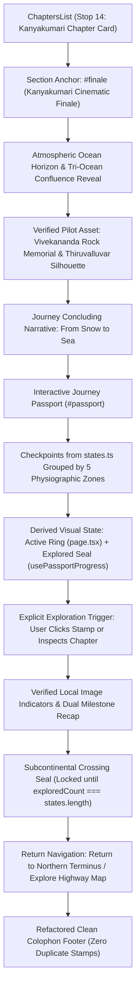
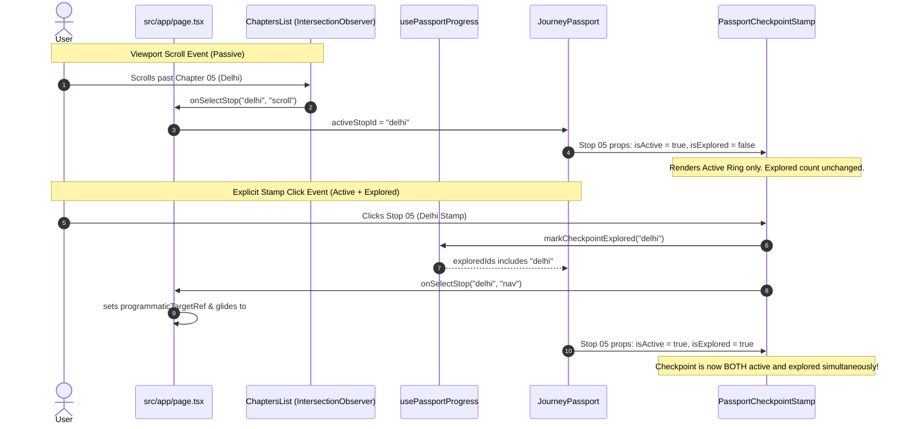

# Phase 1C Step 5 — Technical Execution Plan
## Kanyakumari Finale & Interactive Journey Passport
**The Grand Bharat Highway — Kashmir to Kanyakumari (NH44)**

**Document ID:** `docs/PHASE-1C-STEP-5-TECHNICAL-EXECUTION-PLAN.md`  
**Phase:** Phase 1C — Cinematic Storytelling & Visual Experience  
**Step:** Step 5 of 6 (Kanyakumari Finale & Interactive Passport)  
**Document Revision:** Revision 2.3 (Final Technical Consistency Audit)  
**Author Roles:** Principal Geospatial QA & Frontend Systems Architect, Editorial Experience Lead  
**Status:** **PLANNING STAGE ONLY · IMPLEMENTATION NOT AUTHORIZED**  
**Precondition:** Phase 1C Step 4 formally accepted and closed by project owner on November 27, 2026.  

---

> [!IMPORTANT]
> **PLANNING-ONLY NOTICE & CONSTRAINTS**  
> This document is strictly an architecture, design, and execution blueprint. **Zero code implementation is authorized.**  
> - No application files, types, styles, or content dictionaries will be modified during this stage.
> - No GIS files or basemap datasets will be edited or regenerated.
> - No npm dependencies will be added.
> - No Git commits, branches, stashes, resets, or deployments will be executed.
> - Physical implementation of Step 5 will commence only upon separate, explicit owner authorization.

---

## Document Revision History

| Revision | Date | Author / Role | Description of Changes |
| :---: | :---: | :--- | :--- |
| **1.0** | 2026-11-27 | Principal QA & Frontend Architect | Initial technical execution plan for Step 5. Proposed Kanyakumari Finale (#finale), 5-zone interactive passport (#passport), client-side state hook, and headless browser QA matrix. |
| **2.0** | 2026-11-27 | Principal QA & Frontend Architect | **Post-Owner Review Corrections:**<br>1. Replaced auto-exploration via scroll-spy with explicit interaction model; rapid scrolling updates active state only.<br>2. Added versioned storage key `nh44_passport_progress_v1`, SSR hydration guards, in-memory fallback, and visible reset button.<br>3. Removed ad-hoc 14-stamp grid from `Footer.tsx` to eliminate UI duplication.<br>4. Separated MoRTH listed milestone from OSM distance reference with verbatim owner badge copy. |
| **2.1** | 2026-11-27 | Principal QA & Frontend Architect | **Revision 2.1 Final Technical Clarifications:**<br>1. Decoupled Active and Explored States: Replaced mutually exclusive union with independent state derivation (`isActive` from `activeStopId`, `isExplored` from `exploredIds`). Checkpoints can visually be both active and explored simultaneously.<br>2. Correct Distance Terminology: Standardized to 3,810 KM MoRTH Listed Benchmark and 3,613.79 KM Kanyakumari Checkpoint Projection Reference, avoiding unqualified centerline claims.<br>3. Preserved Single Source of Truth: Zero hardcoded duplicate checkpoint records; passport dynamically derives records from `content/states.ts` and `src/data/journeyProgress.ts`.<br>4. Hydration-Ready UI State & Persistence Boundaries: Added `isHydrated` to prevent false "0/14" flash. Disclosed reload loss for in-memory fallback. Removed blanket offline app claims.<br>5. Owner Approval Checklist Realignment: Labeled architectural items as "Incorporated per owner review — pending final owner sign-off" with unchecked status (`[ ]`). |
| **2.2** | 2026-11-27 | Principal QA & Frontend Architect | **Revision 2.2 Micro-Corrections:**<br>1. Unified Storage Payload Schema: Enforced a single, consistent versioned JSON payload (`version: 1`, `exploredIds`, `lastUpdated`) across all documentation sections and parser pseudocode.<br>2. Dynamic Validation from Single Source of Truth: Removed hardcoded `VALID_CHECKPOINT_IDS` list from proposed implementation. Derived valid IDs dynamically from `content/states.ts`. |
| **2.3** | 2026-11-27 | Principal QA & Frontend Architect | **Revision 2.3 Final Technical Consistency Audit:**<br>1. **Complete Storage Payload Validation:** Updated parser pseudocode in Section 5.5 to validate the entire schema: `parsed.version === 1`, valid ISO-8601 `lastUpdated` timestamp, `Array.isArray(parsed.exploredIds)`, dynamic string ID filtering against `content/states.ts`, and deduplication via `Set`. Discards malformed payloads safely.<br>2. **Dynamic Progress Denominator:** Replaced all hardcoded checkpoint count references in Section 6 progress calculations with dynamic counts derived from `states.length` imported directly from `content/states.ts` (`percentComplete = Math.round((exploredCount / states.length) * 100)`).<br>3. **Navbar `visitedCount` Clarification:** Documented that `<Navbar ... visitedCount={14} />` in `page.tsx` is an existing legacy navigation prop completely separate from the passport's exploration state (`exploredIds`). Confirmed zero alterations to Navbar state architecture or contracts. |

---

## 1. Executive Summary & Core Objective

The primary objective of **Phase 1C Step 5** is to deliver a cinematic, emotionally resonant, and geographically grounded conclusion to **The Grand Bharat Highway (NH44)** digital expedition. 

Having guided the user across 3,810 listed highway kilometres through 12 states and union territories, 14 major checkpoints, and 5 physiographic zones, the interface culminates at India's southern terminus — Cape Comorin (Kanyakumari) — where the Arabian Sea, the Bay of Bengal, and the Indian Ocean converge.

To achieve this without superficial ornamentation or false claims of real-world physical travel, Step 5 introduces two coordinated systems:
1. **The Kanyakumari Cinematic Finale (`#finale`):** A dedicated destination climax revealing the tri-ocean horizon, atmospheric dawn/dusk lighting, an authentic portrait of the Vivekananda Rock Memorial and 133-foot Thiruvalluvar Statue, and a formal concluding narrative reflecting the monumental journey from Himalayan snowlines to the open sea.
2. **The Interactive Journey Passport (`#passport`):** A structured digital expedition log representing exploration progress across all 14 checkpoints grouped by the five approved physiographic zones. The passport transparently frames progress as *digital expedition exploration* (chapters inspected, landmarks investigated), providing verifiable local image indicators, milestone records, and an interactive collectible completion seal gated strictly by deliberate user engagement.

---

## 2. Existing Repository Architecture Findings & Baseline Integration Protection

### 2.1 Central Navigation & Single State Ownership (`src/app/page.tsx`)
- `activeStopId: CheckpointId` resides in `src/app/page.tsx` as the **sole owner of active checkpoint state** (default: `"srinagar"`).
- `handleSelectStop(id, origin)` manages deliberate navigation actions (`origin: "map" | "nav" | "card" | "scroll" | "url" | "initial"`), programmatic scroll guarding (`programmaticTargetRef`), and browser address bar synchronization (`#chapter-{id}`).
- **Baseline Integration Protection:**
  - Existing section anchors (`#hero`, `#chapters`, `#corridor-explorer`) remain strictly unchanged and functional.
  - Adding `#finale` and `#passport` does not interfere with programmatic scroll lock (`programmaticTargetRef`) during chapter transitions.
  - Page layout structure:
    1. `<Navbar activeStopId={activeStopId} onSelectStop={handleSelectStop} visitedCount={14} />`
    2. `<HeroSection />` (Cinematic prologue, 5-zone ribbon)
    3. `<MapSection activeStopId={activeStopId} onSelectStop={handleSelectStop} />` (Corridor Explorer, 5-pass luminous highway spine, LOD 0/1/2 switching)
    4. `<ChaptersList activeStopId={activeStopId} onSelectStop={handleSelectStop} programmaticTargetRef={programmaticTargetRef} />` (14 chapter cards, scroll-spy)
    5. `<KanyakumariFinale activeStopId={activeStopId} onSelectStop={handleSelectStop} />` (**NEW:** houses `#finale` and `#passport`)
    6. `<Footer />` (**REFACTORED:** clean colophon, zero duplicate stamps)

### 2.2 Navbar `visitedCount` Clarification
- In `src/app/page.tsx`, `<Navbar activeStopId={activeStopId} onSelectStop={handleSelectStop} visitedCount={14} />` passes an optional prop `visitedCount?: number` declared on `NavbarProps` in `src/components/navigation/Navbar.tsx`.
- **Repository Verification Finding:** Inspection of `src/components/navigation/Navbar.tsx` confirms that `visitedCount` is an existing legacy navigation prop that is completely unrelated to the interactive passport's exploration state (`exploredIds`). The existing Navbar does not utilize `visitedCount` for progress computation, route gating, or checkpoint state.
- **Strict Boundary:** Step 5 will **not** modify `Navbar`'s existing prop signatures, will not attempt to wire `visitedCount` to `usePassportProgress`, and will not introduce a new navigation-state architecture. Existing Navbar behavior remains completely untouched.

### 2.3 Navigation Origin Contract (`src/types/state.ts`)
- The `NavigationOrigin` union remains:
  ```typescript
  export type NavigationOrigin = "map" | "card" | "nav" | "scroll" | "url" | "initial";
  ```
- Interactions initiated from passport stamps dispatch `handleSelectStop(id, "nav")`, triggering smooth scrolling to `#chapter-{id}` and arming `programmaticTargetRef` to eliminate scroll-spy jitter.

### 2.4 Single Source of Truth & Zero Data Duplication
To preserve architectural integrity, no checkpoint data will be duplicated in static passport files:
- **Checkpoint Metadata:** Names, jurisdictions, descriptions, elevations, biomes, and verified image paths are imported directly from `content/states.ts` (`export const states: StateChapter[]`).
- **Dynamic Checkpoint Count Denominator:** The total checkpoint count is derived directly from `states.length` imported from `content/states.ts`. No hardcoded integers are used as calculation denominators.
- **Journey Progression & Distance Metrics:** Derived dynamically via `getJourneyProgress(checkpointId)` from `src/data/journeyProgress.ts`.
- **Physiographic Zones:** Grouped dynamically using approved Step 2 biome classifications (`src/types/state.ts`).
- **Passport State Storage:** Persists strictly the unified versioned object schema (`PassportStoragePayload`) in `localStorage`. The payload contains only the schema version, the explored checkpoint IDs (`exploredIds: CheckpointId[]`), and an ISO-8601 update timestamp (`lastUpdated`). No checkpoint names, elevations, coordinates, descriptions, or zone metadata are ever duplicated in storage.

### 2.5 Established Project Distance Terminology
In strict compliance with repository measurement definitions (`src/data/journeyProgress.ts` & `data/nh44/nh44-checkpoints-validation.json`):
- **3,810 KM — MoRTH Listed Benchmark:** The official statutory corridor planning benchmark specified under MoRTH Annexure II(d).
- **3,613.79 KM — Kanyakumari Checkpoint Projection Reference:** The orthogonal projection milestone of Kanyakumari (Cape Comorin) along the OpenStreetMap validation reference chain. (The authoritative LOD 0 MultiLineString geometry sum is 3,612.21 KM, reflecting the 1.62 KM omission across 4 structural section gaps; 3,613.79 KM serves as the reference denominator to align with cumulative highway milestones).
- **Rule:** Step 5 will not describe 3,613.79 KM as an unqualified "full-route physical centerline distance," nor recalculate or modify any GIS geometries.

### 2.6 Footer Stamp Duplication Elimination (`src/components/footer/Footer.tsx`)
- The ad-hoc 14-stamp grid in `Footer.tsx` (`states.map((s, idx) => ...)`) will be removed completely.
- The interactive passport belongs solely to `JourneyPassport.tsx` within `#finale`.
- `Footer.tsx` is streamlined into a minimal colophon:
  - Project identity & corridor overview ("The Grand Bharat Highway — Kashmir to Kanyakumari").
  - Navigation links (`#hero`, `#corridor-explorer`, `#chapters`, `#finale`).
  - Formal geospatial provenance notice and MoRTH disclaimer.
  - Image licensing ledger reference and Creative Commons attribution notices.

### 2.7 Cryptographically Locked GIS Foundation
- All five GIS basemap files remain 100% invariant since Phase 1B:
  - `public/data/nh44/nh44-route-lod0.geojson` (`43,089` vertices) — SHA-256: `78f88425...`
  - `public/data/nh44/nh44-route-lod1.geojson` (`4,032` vertices) — SHA-256: `1b07bf05...`
  - `public/data/nh44/nh44-route-lod2.geojson` (`593` vertices) — SHA-256: `6d78013a...`
  - `public/data/nh44/nh44-lod-metadata.json` — SHA-256: `d0a585d6...`
  - `public/data/india.json` — SHA-256: `a6687a91...`

---

## 3. Proposed User Experience & Conceptual Narrative



### 3.1 Kanyakumari Cinematic Finale Experience
- **Arrival Reveal:** Positioned immediately following Chapter 14, the user crosses the final threshold of the highway into a widescreen atmospheric arena (`#finale`).
- **Tri-Ocean Confluence:** Visual storytelling honors the convergence of the **Arabian Sea (West)**, **Indian Ocean (South)**, and **Bay of Bengal (East)**.
- **Atmospheric Palette:** Deep twilight indigo (`#091522`), oceanic teal (`#1D7068`), dawn coral (`#D48439`), and warm horizon gold (`#E9A15C`).
- **Authentic Photographic Display:**
  - Highlights the locally hosted, Creative Commons verified asset:  
    `/images/nh44/14-kanyakumari-rock-memorial.webp`  
    *(Photographer: Shivani, CC BY-SA 4.0 via Wikimedia Commons)*.
  - Accompanied by prominent metadata pills: `Verified Local Pilot Asset`, `3,810 KM Listed Benchmark`, `Southern Terminus`.
- **Visual Ethics & Authenticity Guarantee:**
  - Real photography is framed within verified provenance card boundaries.
  - Illustrative SVG horizons, atmospheric mist layers, and silhouette elements are explicitly presented as vector atmospheric design, never disguised as authentic photographs.
- **Narrative Concluding Climax:**
  > *"Here, at the tapering granite wedge of the Indian peninsula, the road ends where three great bodies of water meet. From the snow-capped Pir Panjal to Cape Comorin, National Highway 44 binds a subcontinent together — 3,810 kilometres of changing earth, living cultures, and continuous human movement."*

### 3.2 Decoupled Active & Explored States
The state model cleanly separates viewport focus from intentional exploration:
1. **Active State Ownership:** Owned strictly by `src/app/page.tsx` via `activeStopId: CheckpointId`. Passport receives `activeStopId` as a prop and computes `isActive = (checkpoint.id === activeStopId)`.
2. **Explored State Ownership:** Owned by `usePassportProgress` via `exploredIds: CheckpointId[]`. Checkpoints are marked `explored` **only upon deliberate user interaction** (clicking a stamp to inspect details or deep-link, clicking "Locate on Map" from a card, or opening chapter media). The passport computes `isExplored = exploredIds.includes(checkpoint.id)`.
3. **Four Independent Visual Render States:**
   - **Unvisited & Inactive (`!isExplored && !isActive`):** Subdued border, muted milestone shield, hollow stamp ring.
   - **Unvisited & Active (`!isExplored && isActive`):** Gold pulse ring, active compass beacon, hollow stamp ring. (Indicates current viewport focus without awarding false exploration credit).
   - **Explored & Inactive (`isExplored && !isActive`):** Rich saffron/gold seal, embossed exploration checkmark, deep-linkable.
   - **Explored & Active (`isExplored && isActive`):** Rich saffron/gold seal, embossed exploration checkmark, **AND** active gold pulse ring / beacon. (The checkpoint is both explored and currently selected!).
4. **Completion Seal Gating:**
   - The **Subcontinental Crossing Completion Seal** remains strictly locked until all checkpoints in `states` are explicitly marked as explored (`exploredCount === states.length`).
   - Rapid scrolling past cards updates `activeStopId` in viewport, but never increments explored count.

### 3.3 Milestone Disambiguation & Completion Experience
The completion badge strictly presents the established project measurement definitions:
- **3,810 KM MoRTH Listed Benchmark**
- **3,613.79 KM Kanyakumari Checkpoint Projection Reference**
- **Framing:** Acknowledged transparently as a digital expedition milestone, explicitly disclaiming proof of physical travel.

#### Owner-Specified Completion Badge Text & Structure
```text
┌────────────────────────────────────────────────────────────────────────┐
│                      DIGITAL EXPEDITION PASSPORT                       │
│                                14 / 14                                 │
│                        SUBCONTINENTAL CROSSING                         │
│               All 14 NH44 digital checkpoints explored.                │
│                            5 Journey Zones                             │
│ 3,810 KM Listed Benchmark · 3,613.79 KM Checkpoint Projection Reference│
│     Digital exploration milestone — not proof of physical travel.      │
└────────────────────────────────────────────────────────────────────────┘
```

- **Interactive Actions:**
  - *Return to Northern Terminus:* Smooth scroll to `#hero` with focus restoration.
  - *Explore Corridor Map:* Smooth scroll to `#corridor-explorer`.
  - *Reset Exploration Progress:* Accessible button to clear stored progress.

---

## 4. Technical Component Architecture

```
src/
└── components/
    ├── finale/
    │   ├── KanyakumariFinale.tsx         <-- Master finale container (#finale)
    │   ├── OceanHorizonAtmosphere.tsx    <-- Restrained SVG tri-ocean visual backdrop
    │   ├── JourneyPassport.tsx           <-- 5-zone interactive passport layout (#passport)
    │   ├── PassportCheckpointStamp.tsx   <-- Individual tactile checkpoint stamp
    │   └── ExpeditionSummaryBadge.tsx    <-- Dual milestone recap & collectible completion seal
    ├── footer/
    │   └── Footer.tsx                    <-- Refactored clean colophon (zero duplicate stamps)
    └── ...
```

### 4.1 Component Breakdown & Props Interface

| Component Name | File Path | Props Received | Primary Responsibility |
| :--- | :--- | :--- | :--- |
| **`KanyakumariFinale`** | `src/components/finale/KanyakumariFinale.tsx` | `activeStopId: CheckpointId`, `onSelectStop: (id: CheckpointId, origin: NavigationOrigin) => void` | Master section layout, landmark photography display, concluding narrative, scroll anchor `#finale`. |
| **`OceanHorizonAtmosphere`** | `src/components/finale/OceanHorizonAtmosphere.tsx` | None | Vector SVG tri-ocean backdrop with dawn/dusk gradients. Disables motion under `useReducedMotion()`. |
| **`JourneyPassport`** | `src/components/finale/JourneyPassport.tsx` | `activeStopId: CheckpointId`, `onSelectStop: (id: CheckpointId, origin: NavigationOrigin) => void` | Renders 5-zone stamp grid, progress meter, reset button. Dynamically derives records from `states` and `usePassportProgress`. |
| **`PassportCheckpointStamp`** | `src/components/finale/PassportCheckpointStamp.tsx` | `checkpoint: StateChapter`, `isActive: boolean`, `isExplored: boolean`, `onExplore: () => void`, `onClick: () => void` | Renders tactile stamp with independent active pulse and explored seal styling. Accessible button with focus ring. |
| **`ExpeditionSummaryBadge`** | `src/components/finale/ExpeditionSummaryBadge.tsx` | `summary: PassportProgressSummary`, `onReset: () => void` | Displays dual milestones, completion seal (gated on `summary.isFullyExplored`), and return buttons. Handles pre-hydration placeholder. |
| **`Footer`** | `src/components/footer/Footer.tsx` | None | Refactored colophon: brand identity, navigation anchors, MoRTH disclaimer, licensing ledger link. |

### 4.2 Data Flow & State Synchronization Sequence



---

## 5. Storage Architecture, Hydration & Resilience

### 5.1 Unified Storage Payload Schema
To ensure total predictability, version resilience, and single-source-of-truth integrity, `localStorage` persists strictly one unified versioned JSON object under the key `nh44_passport_progress_v1`:

```json
{
  "version": 1,
  "exploredIds": [
    "srinagar",
    "delhi"
  ],
  "lastUpdated": "2026-11-27T03:15:00.000Z"
}
```

**Schema Invariants:**
- **Only Checkpoint IDs and Timestamp:** No checkpoint names, elevations, coordinates, descriptions, or zone metadata are persisted.
- **Strict Version Control:** Payloads are tagged with `version: 1`.
- **Dynamic ID Validation:** Valid IDs are not maintained in a separate hardcoded list; they are derived dynamically from `content/states.ts` (`new Set(states.map(s => s.id))`).

### 5.2 Hydration-Ready UI State (`isHydrated`)
A critical defect in naive client-side storage implementations is **progress flash**: rendering `0 / 14` during SSR and initial client mount, then abruptly jumping to stored progress (e.g. `8 / 14`) once `localStorage` is read.

To prevent this:
1. `usePassportProgress` returns an explicit `isHydrated: boolean` flag (starts `false`, set to `true` inside `useEffect` once `localStorage` is parsed).
2. During SSR and pre-hydration client rendering (`!isHydrated`):
   - The summary badge renders a neutral placeholder/skeleton: `— / — Checkpoints Explored`.
   - The completion seal displays an indeterminate loading state, never claiming "0 / 14" as a confirmed stored value.
3. Once `isHydrated === true`, the confirmed explored count renders smoothly without layout shift or UI flicker.

### 5.3 Storage Fallback & Non-Persistence Disclosure
If `localStorage` is unavailable, throws a security exception (e.g. Safari Private Browsing mode, Firefox Strict Content Blocking), or exceeds quota:
- All operations are wrapped in `try/catch`.
- `usePassportProgress` silently falls back to in-memory React state (`useState`).
- **Non-Persistence Reality:** In this fallback mode, exploration progress remains interactive during the active session but **will not persist after a page reload or tab close**. This boundary is clearly documented in the component and verified via QA.

### 5.4 Scope of Client-Side Persistence (No False Offline Claims)
- `localStorage` provides **strictly client-side local state persistence** for the user's explored checkpoint stamps across browser reloads using the versioned `PassportStoragePayload` schema.
- It does **not** make the entire web application work offline. External web fonts, map tile layers, and remote media still require active network connectivity.

### 5.5 Complete Storage Payload Validation & Corrupted Payload Recovery
To prevent corrupted storage from breaking the application, parser pseudocode derives valid IDs dynamically from the single source of truth (`content/states.ts`), validates `version === 1`, ensures a valid ISO-8601 timestamp, removes duplicate IDs, and gracefully discards unrecognized IDs:

```typescript
import { states } from "@content/states";
import { CheckpointId } from "@/types/state";

// Dynamically derived from single source of truth (content/states.ts)
const VALID_CHECKPOINT_IDS = new Set<string>(states.map((s) => s.id));

export function parseStoredProgress(raw: string | null): CheckpointId[] {
  if (!raw) return [];
  try {
    const parsed = JSON.parse(raw);

    // 1. Must be a non-null object and not an array
    if (!parsed || typeof parsed !== "object" || Array.isArray(parsed)) {
      return [];
    }

    // 2. Strict version check
    if (parsed.version !== 1) {
      return [];
    }

    // 3. Valid ISO-8601 timestamp validation
    if (
      typeof parsed.lastUpdated !== "string" ||
      isNaN(Date.parse(parsed.lastUpdated))
    ) {
      return [];
    }

    // 4. exploredIds must be an array
    if (!Array.isArray(parsed.exploredIds)) {
      return [];
    }

    // 5. Retain valid string IDs, discard unknown IDs, and deduplicate
    const uniqueIds = new Set<CheckpointId>();
    for (const item of parsed.exploredIds) {
      if (typeof item === "string" && VALID_CHECKPOINT_IDS.has(item)) {
        uniqueIds.add(item as CheckpointId);
      }
    }

    return Array.from(uniqueIds);
  } catch {
    return [];
  }
}
```
If stored data is unparseable, malformed, contains an invalid timestamp, or has an invalid version, it safely initializes to an empty array without throwing.

---

## 6. Data & State Model (`src/types/state.ts`)

```typescript
import { states } from "@content/states";
import { CheckpointId, BiomeId } from "@/types/state";

/**
 * Passport exploration progress summary.
 * All progress metrics derive their denominator dynamically from states.length.
 */
export interface PassportProgressSummary {
  totalCount: number; // Derived dynamically: states.length
  exploredCount: number; // Derived: exploredIds.length (0 to states.length)
  percentComplete: number; // Derived: states.length > 0 ? Math.round((exploredCount / states.length) * 100) : 0
  isFullyExplored: boolean; // Derived: states.length > 0 && exploredCount === states.length
  isHydrated: boolean; // true once client-side localStorage read settles
  lastExploredId: CheckpointId | null;
}

/**
 * Unified storage payload stored in localStorage under 'nh44_passport_progress_v1'.
 * Contains strictly version, IDs, and ISO-8601 timestamp; zero duplicated content.
 */
export interface PassportStoragePayload {
  version: 1;
  exploredIds: CheckpointId[];
  lastUpdated: string; // ISO 8601 string
}

/**
 * Dynamically derived stamp view-model (never stored statically).
 */
export interface DerivedPassportStamp {
  id: CheckpointId;
  order: number;
  name: string;
  stop: string;
  morthMilestoneKm: number;
  projectionReferenceKm: number; // 3,613.79 KM Kanyakumari projection reference
  elevation: string;
  zoneId: BiomeId;
  zoneName: string;
  hasVerifiedLocalAsset: boolean;
  isActive: boolean;    // Derived: id === activeStopId (from page.tsx)
  isExplored: boolean;  // Derived: exploredIds.includes(id) (from usePassportProgress)
}
```

---

## 7. File-Level Implementation Scope

When owner authorization is granted, modifications will be restricted strictly to the following files:

### 7.1 Files to Create
1. `src/components/finale/KanyakumariFinale.tsx` — Master finale section layout (`#finale`).
2. `src/components/finale/OceanHorizonAtmosphere.tsx` — Vector atmospheric tri-ocean backdrop.
3. `src/components/finale/JourneyPassport.tsx` — 5-zone passport grid container (`#passport`).
4. `src/components/finale/PassportCheckpointStamp.tsx` — Tactile stamp card component.
5. `src/components/finale/ExpeditionSummaryBadge.tsx` — Dual milestone recap & collectible completion seal.
6. `src/hooks/usePassportProgress.ts` — Client-side exploration state hook with complete schema validation, hydration-ready flag, in-memory fallback, dynamic ID validation, and deduplication.
7. `scripts/qa/step5_browser_qa.js` — Automated Chrome Headless CDP verification script.

### 7.2 Files to Modify
1. `src/types/state.ts` — Add passport progress types (`PassportProgressSummary`, `PassportStoragePayload`, `DerivedPassportStamp`).
2. `src/app/page.tsx` — Mount `<KanyakumariFinale />` between `<ChaptersList />` and `<Footer />`; pass `activeStopId` and `handleSelectStop`.
3. `src/components/footer/Footer.tsx` — Refactor into clean colophon: remove ad-hoc 14-stamp grid; retain branding, navigation links, and MoRTH disclaimer.
4. `src/components/navigation/Navbar.tsx` — Add quick anchor `#finale` using the existing `scrollTo("finale")` pattern without altering existing props or state architecture.

### 7.3 Prohibited Files (Zero Changes)
- `public/data/nh44/*` (all 3 LOD GeoJSONs + metadata JSON) — **STRICTLY IMMUTABLE**.
- `public/data/india.json` — **STRICTLY IMMUTABLE**.
- `content/states.ts` — Zero data restructuring; consumed as single source of truth.
- `src/data/journeyProgress.ts` — Consumed as-is.
- `package.json` — Zero dependency additions.

---

## 8. Visual Design Direction & Photography Ethics

### 8.1 Atmospheric Horizon & Color Spectrum
- **Lighting Mood:** Cape Comorin at twilight/dawn — soft oceanic horizon where sky and three seas blend.
- **Color Variables (Tailwind & Hex Tokens):**
  - Horizon Saffron Core: `#E9A15C`
  - Deep Twilight Abyssal: `#091522`
  - Confluence Teal: `#1D7068`
  - Cape Granite Sand: `#D9B88F`
  - Celestial Ivory: `#F2EBDD`
  - Muted Text Gray: `#A2B3C4`
- **Illustrative Backdrop:** Crafted purely using SVG vector paths, radial gradient blooms, and CSS filters (`backdrop-blur`). **No heavy canvas animations or WebGL shaders.**

### 8.2 Strict Photographic Authenticity Guidelines
- **Real Photograph Usage:**
  - The Vivekananda Rock Memorial photograph (`/images/nh44/14-kanyakumari-rock-memorial.webp`) is displayed with full attribution to photographer Shivani under CC BY-SA 4.0.
  - Rendered with sharp borders, verified badge overlay, and explicit photo captions.
- **Boundary with Illustrative Visuals:**
  - Background gradients, horizon curves, and passport stamp seals are intentionally rendered in clean, stylized vector aesthetics (metallic stamps, linework, dashed borders).
  - No synthetic visual is ever labeled as a "photograph" or "satellite capture".

---

## 9. Accessibility & Responsive Strategy

### 9.1 Accessibility (WCAG 2.2 Level AA Compliance)
- **Keyboard Navigation:** Every checkpoint stamp in the passport is an accessible button or anchor with visible high-contrast focus rings (`focus-visible:ring-2 focus-visible:ring-[#E9A15C] focus-visible:ring-offset-2`).
- **Screen Reader Support:**
  - Dynamic ARIA status: `aria-label="Stop 01: Srinagar, Jammu & Kashmir — Explored: Yes, Active: No"`
  - Passport progress meter: `role="progressbar"` with `aria-valuenow`, `aria-valuemin="0"`, `aria-valuemax={states.length}`.
- **Reduced Motion:**
  - All Framer Motion transitions listen to `useReducedMotion()`.
  - When reduced motion is preferred, transitions are instant (`duration: 0`), parallax is disabled, and pulsing animations are neutralized (`motion-reduce:animate-none`).
- **Color Contrast:** All body text meets minimum $4.5:1$ contrast against dark backgrounds; all large headings meet $3:1$.

### 9.2 Responsive Layout Blueprint

| Viewport | Container Width | Finale Layout | Passport Layout | Navigation Controls |
| :--- | :---: | :--- | :--- | :--- |
| **Desktop (1440px)** | `max-w-7xl` | 2-column panoramic split (Atmospheric horizon + landmark photography on left, narrative + expedition summary on right) | 5-zone structured grid ledger | Full keyboard traversal, hover elevation effects |
| **Tablet (768px)** | `px-6` | Stacked hero with full-width photography card | 2-column responsive stamp cards grouped by zone cards | Touch-friendly stamps ($\ge 44\text{px}$ touch target) |
| **Mobile (390px)** | `px-4` | Single-column fluid stacked layout | Compact 2-column stamp grid with zone headers | Sticky zone progress pill, thumb-friendly actions |
| **Small Mobile (360px)** | `px-3` | Fluid typography (`text-3xl`), zero horizontal overflow | Single/2-column compact stamps with truncated labels | Clear spacing between stamp and return button |

---

## 10. Quality Assurance & Objective Verification Matrix

A dedicated headless Chrome DevTools Protocol (CDP) test script (`scripts/qa/step5_browser_qa.js`) will validate the following criteria upon future authorization:

| Test ID | Test Category | Objective Verification Criteria | Pass Condition |
| :--- | :--- | :--- | :--- |
| **T5-01** | **Type Safety** | Run `npx tsc --noEmit` across all application and content files. | Return Code 0; zero type errors. |
| **T5-02** | **Code Quality** | Run `npm run lint`. | Return Code 0; zero ESLint warnings or errors. |
| **T5-03** | **Production Build** | Run `npm run build`. | Return Code 0; successful static page compilation. |
| **T5-04** | **GIS Invariance** | Verify SHA-256 hashes of all 5 protected basemap files. | 100% hash match with Phase 1B baseline. |
| **T5-05** | **14 Checkpoints** | Audit passport DOM nodes for all checkpoints in strict sequence. | Exactly `states.length` stamps rendered matching `states.ts`. |
| **T5-06** | **5 Zones** | Audit zone grouping headers and stamp assignments. | All 5 zones match Step 2 approved titles. |
| **T5-07** | **Explicit vs Viewport** | Rapid page scroll updates `activeStopId` (`isActive: true`), but does **NOT** increment `exploredIds`. | Explored count remains 0 after scroll-spy pass. |
| **T5-08** | **Active + Explored State** | Click stamp 05 (Delhi); verify stamp is both active and explored simultaneously. | `isActive === true && isExplored === true`. |
| **T5-09** | **Seal Gating** | Verify completion seal is locked when `exploredCount < states.length`, and unlocks when `exploredCount === states.length`. | Seal DOM element conditionally renders unlocked state. |
| **T5-10** | **Unified Storage Schema** | Inspect `localStorage` item `nh44_passport_progress_v1`. | Matches `{ version: 1, exploredIds: [...], lastUpdated: "..." }` with valid ISO-8601 timestamp. |
| **T5-11** | **Hydration State Guard** | Inspect summary badge during initial mount before hydration. | Renders placeholder skeleton; no flash of false "0/14". |
| **T5-12** | **Corrupted Storage Recovery** | Inject corrupted/invalid-version/invalid-timestamp JSON into `localStorage` and mount page. | Zero crash; gracefully initializes empty explored set. |
| **T5-13** | **Dynamic ID Validation** | Inject unrecognized string or duplicate IDs into `exploredIds` in storage. | Parser filters unknown IDs and deduplicates using dynamic `states.ts` set. |
| **T5-14** | **Storage Fallback** | Simulate `localStorage` throwing `QuotaExceededError`. | In-memory fallback keeps app interactive; documents reload loss. |
| **T5-15** | **Reset Progress Control** | Click "Reset Exploration Progress" button. | Storage wiped; explored count resets to 0; seal locks. |
| **T5-16** | **Footer Deduplication** | Inspect `Footer.tsx` DOM tree. | Zero duplicate checkpoint stamps in footer colophon. |
| **T5-17** | **Distance Terminology Audit** | Check DOM text for milestone metrics. | Displays "3,810 KM Listed Benchmark" and "3,613.79 KM Checkpoint Projection Reference". |
| **T5-18** | **Deep-Link Clicks** | Click stamp 05 (Delhi) and verify viewport scrolls to `#chapter-delhi`. | Window hash and scroll position match target. |
| **T5-19** | **Cross-Device Overflow** | Test `scrollWidth <= innerWidth` across 1440px, 768px, 390px, 360px. | `hasOverflow === false` on all 4 viewports. |
| **T5-20** | **Reduced Motion** | Emulate `prefers-reduced-motion: reduce` in Chrome CDP. | Atmospheric animations disabled; instant renders. |
| **T5-21** | **Keyboard Focus** | Tab through all passport controls and verify focus visibility. | Active element has visible outline; no focus trap. |
| **T5-22** | **Kanyakumari Image** | Verify `/images/nh44/14-kanyakumari-rock-memorial.webp` load state. | HTTP 200, `complete === true`, `naturalWidth > 0`. |
| **T5-23** | **Zero Agra References** | Grep codebase for unapproved "Agra" references. | Exactly 0 matches. |
| **T5-24** | **Baseline Regressions** | Verify `#hero`, `#chapters`, and `#corridor-explorer` remain functional. | All existing anchors and map interactions pass. |

---

## 11. Estimated Phased Implementation Sequence

When authorized by the project owner, Step 5 will be executed in five disciplined, sequential sub-steps:

```
┌─────────────────────────────────────────────────────────────────────────────┐
│                 PROPOSED PHASE 1C STEP 5 EXECUTION SEQUENCE                 │
├─────────────────────────────────────────────────────────────────────────────┤
│ Step 5.1: Types & Resilient Storage Hook                                    │
│   • Define `PassportProgressSummary` and derived stamp types in `state.ts`  │
│   • Implement SSR-safe `usePassportProgress.ts` with complete schema        │
│     validation, hydration-ready state, in-memory fallback, and deduplication│
├─────────────────────────────────────────────────────────────────────────────┤
│ Step 5.2: Kanyakumari Finale Component Architecture                         │
│   • Build `src/components/finale/KanyakumariFinale.tsx`                     │
│   • Implement `OceanHorizonAtmosphere.tsx` with reduced-motion support      │
│   • Integrate verified Vivekananda Rock Memorial pilot asset                │
├─────────────────────────────────────────────────────────────────────────────┤
│ Step 5.3: Interactive Journey Passport Grid                                 │
│   • Build `JourneyPassport.tsx` & `PassportCheckpointStamp.tsx`             │
│   • Connect 5-zone groupings and verified local asset badges                │
│   • Build `ExpeditionSummaryBadge.tsx` with dual milestones and seal        │
├─────────────────────────────────────────────────────────────────────────────┤
│ Step 5.4: Page Integration & Footer Refactoring                             │
│   • Mount finale section in `src/app/page.tsx`                              │
│   • Refactor `Footer.tsx` (remove ad-hoc stamps, clean colophon)            │
│   • Connect return-to-top and map exploration jump actions                  │
├─────────────────────────────────────────────────────────────────────────────┤
│ Step 5.5: Multi-Device Browser QA & Verification Report                     │
│   • Author `scripts/qa/step5_browser_qa.js`                                 │
│   • Capture fresh 1440px, 768px, 390px, 360px screenshots                   │
│   • Author `docs/PHASE-1C-STEP-5-IMPLEMENTATION-REPORT.md`                  │
└─────────────────────────────────────────────────────────────────────────────┘
```

---

## 12. Explicit Out-of-Scope Items

To avoid scope creep and maintain absolute compliance with project standards:
- **Zero Audio:** No ocean wave sound effects, ambient music, or audio narrations.
- **No Synthetic AI Landscapes Represented as Photographs:** Any illustrative vector visuals will be clearly differentiated from real photography.
- **Zero Backend / Server Infrastructure:** No user login, cloud database, or third-party tracking.
- **Zero GIS Re-simplification or Projection Changes:** The 5 protected GeoJSON files remain 100% untouched.
- **No New npm Packages:** No Three.js, Canvas libraries, or external passport plugins.
- **No Physical Travel Claims:** Progress is strictly framed as digital exploration of the corridor narrative.
- **No Blanket Offline Application Claims:** Local storage persists client exploration progress only; external assets require standard network connectivity.
- **No Navbar State Architecture Changes:** The existing `Navbar` prop signature and behavior remain unmodified.

---

## 13. Owner Approval Checklist & Sign-Off Criteria

Before implementation may proceed, the project owner should review and sign off on the following architectural choices:

- [ ] **Exploration Logic Revision:** Incorporated per owner review — pending final owner sign-off. (Gated exploration based on deliberate user engagement; `activeStopId` owned by `page.tsx`, `exploredIds` owned by `usePassportProgress`; checkpoints can visually be both active and explored; rapid scrolling updates active state only and does not auto-stamp or unlock the completion seal).
- [ ] **Storage Resilience & Complete Payload Validation:** Incorporated per owner review — pending final owner sign-off. (Unified schema `PassportStoragePayload` with `version: 1`, `exploredIds`, ISO-8601 `lastUpdated`; complete schema validation, dynamic validation against `content/states.ts`, deduplication via Set; SSR hydration guard, explicit `isHydrated` state; `try/catch` with in-memory fallback and documented reload non-persistence; visible reset button).
- [ ] **Footer Stamp Deduplication:** Incorporated per owner review — pending final owner sign-off. (Complete removal of ad-hoc 14-stamp grid from `Footer.tsx`, preserving clean colophon).
- [ ] **Milestone Disambiguation & Single Source of Truth:** Incorporated per owner review — pending final owner sign-off. (Authoritative separation of 3,810 KM MoRTH Listed Benchmark from 3,613.79 KM Kanyakumari Checkpoint Projection Reference; dynamic derivation of all checkpoint metadata and progress denominator from `content/states.ts` and `src/data/journeyProgress.ts` with zero hardcoded duplicate records; Navbar `visitedCount` clarified as existing unrelated prop).
- [ ] **Explicit Implementation Authorization:** Separate formal command authorizing the start of Phase 1C Step 5 code modifications.

---

*End of Planning Document · Execution Halted Pending Owner Authorization*
